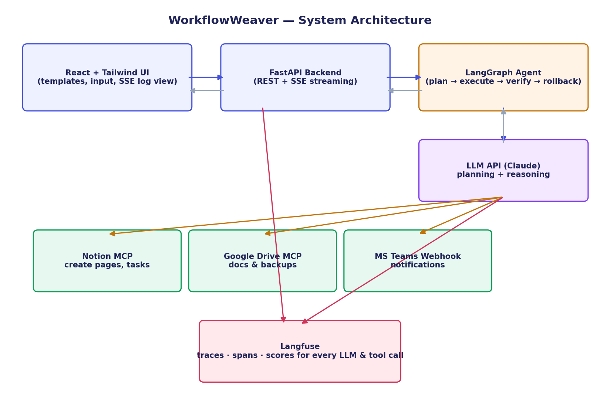

# WorkflowWeaver

AI agent that turns a plain-English business process into a multi-tool workflow run across Notion, Google Drive, Google Calendar, and Microsoft Teams — with live progress, retries, rollback, and full observability.

> FDE-CAPSTONE-001 · Agentic Automation

---

## 1. Project Overview

A business user describes a workflow in natural language, for example:

> "Take today's meeting notes and create a Notion project page, generate action items, and post a summary to Microsoft Teams."

A LangGraph agent, reasoning with an LLM, turns this into a structured multi-step plan and executes it autonomously across connected tools via **MCP (Model Context Protocol)** servers and webhooks. Execution streams live to the UI over **Server-Sent Events**, every step is retried with exponential backoff on failure, and if a step fails permanently the agent **rolls back** everything it already created in that run. Every LLM call and tool invocation is traced in **Langfuse**.

## 2. Architecture Description



| Layer | Tech | Responsibility |
|---|---|---|
| UI | React + Tailwind (Vite) | Natural-language input, template picker, live SSE log, execution report |
| API | FastAPI | REST endpoints + SSE streaming, run/session state |
| Orchestration | LangGraph | Stateful graph: `parse_intent → plan_actions → execute_step ⇄ verify_step → (rollback) → build_report` |
| Reasoning | Groq (Llama 3.3 70B, OpenAI-compatible API) | Converts NL description into a structured JSON action plan |
| Tools | Notion MCP, Google Drive MCP (also provides Calendar), MS Teams Webhook | Executes the actual cross-tool actions |
| Observability | Langfuse | One trace per run; a span per LLM call and per tool invocation, with latency, cost, and success scores |

**Graph control flow:**

```
START → parse_intent → plan_actions → execute_step → verify_step
                                            ▲              │
                                            └── retry ──────┤
                                                             ├─ more steps, no failure → execute_step
                                                             ├─ all steps done, no critical failure → build_report → END
                                                             └─ critical failure (retries exhausted) → rollback → build_report → END
```

- **Retries**: each step gets up to `MAX_RETRIES` attempts with exponential backoff (`RETRY_BASE_DELAY_SECONDS * 2^attempt`).
- **Rollback**: on critical failure, previously-successful reversible steps (Notion page creation, Drive doc creation, calendar event creation) are undone in reverse order. Teams messages can't be unsent, so the agent posts a correction message instead.

**Google Calendar**: scheduling ("schedule a follow-up meeting...") is a fifth action type (`calendar.create_event`), added as a bonus capability beyond the minimum spec. It reuses the same Google Drive MCP server and OAuth token (that server bundles Calendar tools and the token already carries the `calendar.events` scope) — no separate container or auth flow needed. The planner is given the current date so it can resolve relative dates like "next Monday".

## 3. Setup Instructions

### Prerequisites
- Python 3.10+
- Node.js 18+ and npm
- Docker Desktop (to run the Notion and Google Drive MCP servers)
- API keys/credentials listed below

### Clone & configure
```bash
cd workflowweaver
cp .env.example .env
# fill in .env with your own credentials — see Environment Variables below
```

### Start the MCP servers
The Notion and Google Drive MCP servers run as Docker containers (see `docker-compose.yml`).
The backend attaches to them via `docker exec -i` for the MCP stdio transport, so they must be
up before you start the backend:

```bash
docker compose up -d
```

This builds two long-running containers (`notion-mcp`, `gdrive-mcp`) that install and host the
MCP server packages; `NOTION_TOKEN` and the mounted `credentials.json` are picked up from your `.env`.

## 4. Environment Variables

Set these in `.env` (see `.env.example` for the template):

| Variable | Description |
|---|---|
| `LLM_API_KEY` | Groq API key (console.groq.com/keys) |
| `LLM_MODEL` | Groq model identifier (default: `llama-3.3-70b-versatile`) |
| `NOTION_TOKEN` | Notion internal integration token |
| `NOTION_PAGE_ID` | Parent page the agent creates pages under |
| `GOOGLE_CREDENTIALS_PATH` | Path to Google OAuth `credentials.json` |
| `GOOGLE_DRIVE_FOLDER_ID` | Target Drive folder for created docs |
| `TEAMS_WEBHOOK_URL` | Incoming/Workflow webhook URL for your Teams channel |
| `LANGFUSE_PUBLIC_KEY` / `LANGFUSE_SECRET_KEY` / `LANGFUSE_HOST` | Langfuse project credentials |
| `MAX_RETRIES` | Max retry attempts per step (default `3`) |
| `RETRY_BASE_DELAY_SECONDS` | Base delay for exponential backoff (default `1.0`) |
| `CORS_ORIGINS` | Allowed frontend origin(s) |

## 5. Backend Run Instructions

```bash
cd backend
python -m venv .venv && source .venv/bin/activate   # Windows: .venv\Scripts\activate
pip install -r requirements.txt

# Make sure the MCP containers are running first: docker compose up -d (see above)

uvicorn app.main:app --port 8000
```
Health check: `GET http://localhost:8000/health`

> **Do not pass `--reload` on Windows.** Every tool call shells out to `docker exec` as a
> subprocess, which requires the Proactor event loop; uvicorn's `--reload` watcher on Windows
> forces the Selector event loop, which can't create subprocesses at all. The failure is silent —
> tool calls fail instantly with an *empty* error message, retried three times, then rolled back.
> If you need autoreload during development, restart the process manually after edits instead.

## 6. Frontend Run Instructions

```bash
cd frontend
npm install
npm run dev
```
Open `http://localhost:5173`. The Vite dev server proxies `/api/*` to `http://localhost:8000`.

## 7. Sample Workflow Examples

**Meeting Notes → Tasks**
> "Take today's meeting notes and create a Notion project page, generate action items for each owner mentioned, and post a summary to Microsoft Teams."

**Sprint Planning Kickoff**
> "Create a Notion page for Sprint 14 planning with the goals I list, save a copy as a Google Doc in the team folder, and post the sprint goal to Teams."

**Incident Response Log**
> "We have an incident: create a Notion incident page with severity and impact, save the timeline to Google Drive, and alert the on-call Teams channel immediately."

**Meeting Follow-up** (exercises the Calendar action)
> "Here are today's meeting notes: [notes]. Create a Notion page summarizing this meeting, schedule a 30-minute follow-up meeting for next Monday at 3pm, and post a summary to Microsoft Teams."

Five templates ship out of the box — see `backend/app/templates.py`.

## 8. Known Limitations

- This deployment's `TEAMS_WEBHOOK_URL` points at a webhook.site endpoint, not a live Microsoft Teams channel: the available Microsoft account is a personal/consumer account, and Workflows (the connector that generates an Incoming Webhook URL) is a Microsoft 365 work-or-school-only feature — it isn't exposed on the consumer tier at all. `teams_tool.py` is otherwise unchanged and POSTs the same Adaptive Card payload it would send to a real Teams channel; pointing `TEAMS_WEBHOOK_URL` at a real Workflow webhook on an M365 tenant is a drop-in swap, no code change required.
- MCP sessions in `notion_tool.py` / `gdrive_tool.py` / `calendar_tool.py` are opened and closed per call rather than pooled; a production build would reuse sessions per run for lower latency and fewer subprocess spawns.
- The Google Drive MCP container occasionally logs `Failed to persist refreshed tokens ... EBUSY` when the bind-mounted `gdrive-tokens.json` is renamed under Docker Desktop on Windows. Harmless in practice — the refresh token is stable and gets re-exchanged on the next call — but a production setup would mount a directory (not a single file) to avoid the rename-based write pattern entirely.
- `WorkflowRunRequest.config` (per-run workspace/folder/channel overrides) is accepted by the API but not yet read by any node — every run uses the `.env`-configured Notion page, Drive folder, and Teams webhook regardless of `config`.
- Teams messages cannot be programmatically deleted (webhook API limitation) — rollback posts a correction message rather than removing the original.
- Run/session state is stored in-memory (`_runs`, `_run_queues` in `main.py`); restarting the backend loses in-flight run history. Swap in Redis/Postgres for production.
- The planner assumes the LLM returns valid JSON; malformed output currently degrades to an empty plan rather than an automatic reprompt/repair loop.
- No auth/multi-tenant support — this scaffold assumes a single trusted user per deployment.
- The MCP containers (`docker-compose.yml`) install their npm package on every `docker compose up`; a production image would bake the package in at build time instead.

---

*Skills validated: Agentic AI Design · MCP Tool Orchestration · LangGraph Workflow Design · LLM Observability (Langfuse) · Distributed Workflow Mgmt · Error Handling & Recovery · Enterprise Automation · Real-Time Streaming (SSE) · Prompt Engineering · Full-Stack Development*
